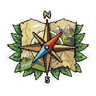
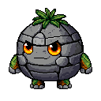
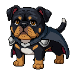
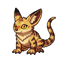
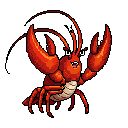
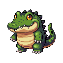
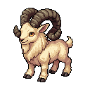

<p align="center">
  
</p>

<h1 align="center">Atlaswild</h1>

<p align="center">Track creatures across real maps. Learn geography. Befriend them all.</p>

<p align="center">
  
  
  
  
  
  
</p>

Atlaswild is a browser game for kids that makes geography practice feel like an expedition. You pick a mystery creature, follow it from place to place using clues, win quiz-powered battles, and bring it home to your stable. It covers the whole world: all 50 US states, 196 countries on six continents, and 10 Antarctic landmarks. Big continents are split into smaller regions, 21 in all, so each map stays readable.

## Install

You need [Node.js](https://nodejs.org) (a current LTS version) and Git.

```bash
git clone git@github.com:clintkelly/geography.git
cd geography
npm install
```

## Run

```bash
npm run dev
```

Then open http://localhost:5199.

Saves live in your browser, on that computer, at that address. Nothing goes online. Clearing browser data erases them, so use **Settings and backup** at camp to download a backup now and then.

## How to play

1. **Pick an explorer.** Each player has their own save.
2. **Pick a sighting at camp.** Choose a region, a trail length, and a difficulty.
3. **Prepare.** Pick a team of up to 5 from your stable and spend Trail Points in the Prep Shop, or save them for clues. Creatures hit harder in their home landscapes, and you can switch during a fight.
4. **Follow the trail.** Use clues and the free atlas to work out where the creature went.
5. **Win encounters.** Choose Attack, Guard, or your Special, then answer a question. A right answer makes your move work. Changed your mind? You can pick another move before you answer, and the question stays the same.
6. **Befriend the creature.** Wear it down in the final showdown, then answer one more question to bring it home.

Field Notes after right answers are worth reading. They come back as Field Note checks, which land as critical hits.

Along the way you can fill the Explorer's Map, level up and evolve your companions, and collect badges and cards, which rise from Bronze to Silver, Gold, and Shiny as you remember more.

Every creature has a **type**, and each type is strong against one other, so mixing types on your team helps. Finish a trail in every region of a continent and its **Continent Boss** appears at Camp. Choose **Everything**, **Places and capitals** or **Flags** to set what a trail asks about, and collect stamps in your **Passport**.

Want a creature in the middle of a fight? Once one you don't own is at half HP, spend 2 charge on **Bold Befriend** and get two harder questions right in a row. Play well and your Trail Score rises, raising your chance of a **rare encounter**.

| Difficulty | What changes |
| --- | --- |
| Scout | Wrong answers are far away |
| Ranger | Close calls, like other cities in the same state |
| Expert | Find places on a blank map |

### Keyboard

The whole game works from the keyboard. Buttons show their keys.

| Where | Keys |
| --- | --- |
| Anywhere | **Enter** or **Space** for the main action, **Tab** to move between buttons |
| Camp | **R** region, **L** trail length, **T** sighting, **1–3** difficulty, **P** switch explorer, **O** settings, **F** question focus, **V** Passport |
| Prep Shop | **1–9** add or remove a team member, **S**, **C**, **T** to buy |
| Finding a place | **1–4** choose, **C** clue, **N** narrow the search, **A** atlas |
| Blank maps | Arrow keys move the highlight, **Enter** chooses |
| Battle | **A** Attack, **G** Guard, **S** Special, **W** switch creature, **H** Trail Snack, **B** Befriend or Bold Befriend, **C** or **Esc** change move, **1–4** answer |
| Maps | **+** and **−** zoom |

## Update it with Claude

This game is built with [Claude Code](https://claude.com/claude-code), and that's the easiest way to change it. From this folder, run:

```bash
claude
```

Then describe what you want in plain English:

- "Add the countries of South America as a new region."
- "Make Expert harder."
- "Add a new creature for the Pacific Northwest, with poses."
- "The hit sound is too loud."

To continue an earlier conversation, use `claude --continue`.

**Art and sound** come from the [PixelLab](https://www.pixellab.ai/mcp) and ElevenLabs MCP servers, which Claude can use once you connect your own accounts. Claude can't hear audio, so it measures sounds, and a person should listen at http://localhost:5199/?sounds.

**Facts** live in `src/content/us/*.json` and `src/content/europe/countries.json`, and questions are built from those records. Tests catch structural problems, not wrong facts, so check new facts yourself. `docs/FACT_REVIEW.md` records what's been verified.

### Checks

```bash
npm test          # game rules, content, and every art and sound file
npm run dev       # in one terminal, then in another:
npm run smoke     # plays real expeditions in a browser
npm run build     # type-check and production build
```

The browser test needs Playwright's browser the first time: `npx playwright install chromium`.

## How it's built

TypeScript, React, and Vite, with no backend. Game rules live in `src/engine` as pure functions, content in `src/content`, saves in `src/persistence`, and screens in `src/ui`. See `docs/PRD.md` for how the game should behave and `docs/ENGINEERING_PLAN.md` for how it's built.

All creatures are original to this game.
